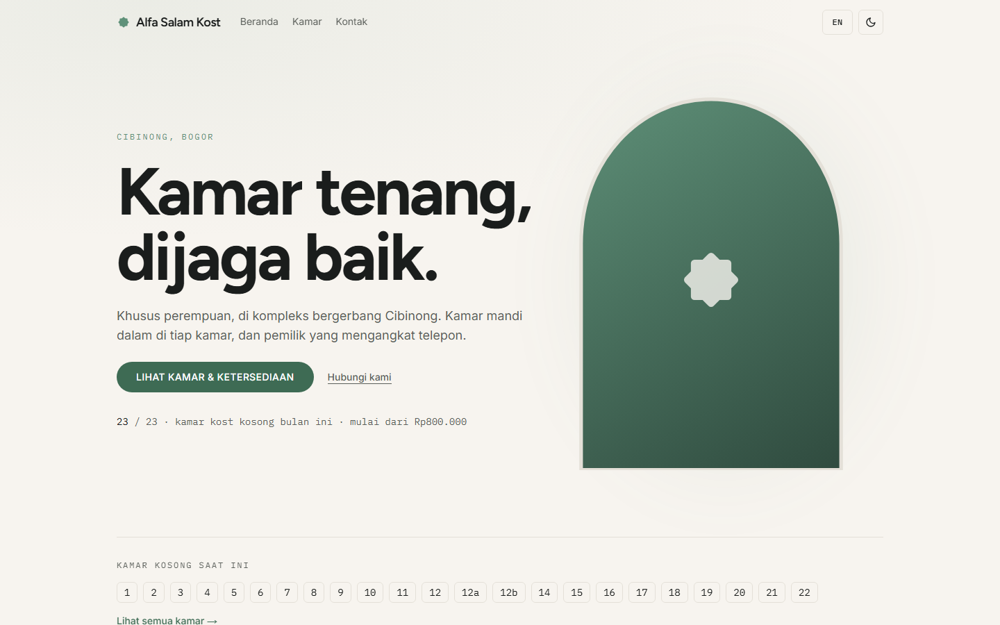

# Alfa Salam Kost & Rukost — Site

[](https://alfasalamkost.aljuhaeda.com)

Public-facing site for a boarding-house (kost) and rental-house (rukost)
business in Cibinong, Bogor. Live at
**[alfasalamkost.aljuhaeda.com](https://alfasalamkost.aljuhaeda.com)**
(also `alfa-salam-kost-site.vercel.app`, auto-deployed from `master`).

`/` and `/rooms` render live rooms and month availability from a shared
Supabase project; `/contact` carries the real contact details. `/rukost`
redirects into `/rooms#rukost`, `/about` into `/`. Companion to the staff
[alfa-salam-kost-dashboard](https://github.com/aljuhaeda/alfa-salam-kost-dashboard).

Full redesign ("Rumah × Pelita") with a dependency-free Awwwards-style
motion pass shipped 2026-08-29. See [PROGRESS.md](PROGRESS.md) for status.

## Getting started

```bash
npm install
npm run dev
```

Requires a `.env.local` with `NEXT_PUBLIC_SUPABASE_URL` and
`NEXT_PUBLIC_SUPABASE_ANON_KEY` for the shared Supabase project (see
[src/lib/supabase.ts](src/lib/supabase.ts)).

## Stack

- Next.js 16, React 19, Tailwind CSS
- Supabase (anon-key client only, no auth)
- Dependency-free motion — CSS + IntersectionObserver + rAF, gated on
  `prefers-reduced-motion`, content renders fully visible with no JS
